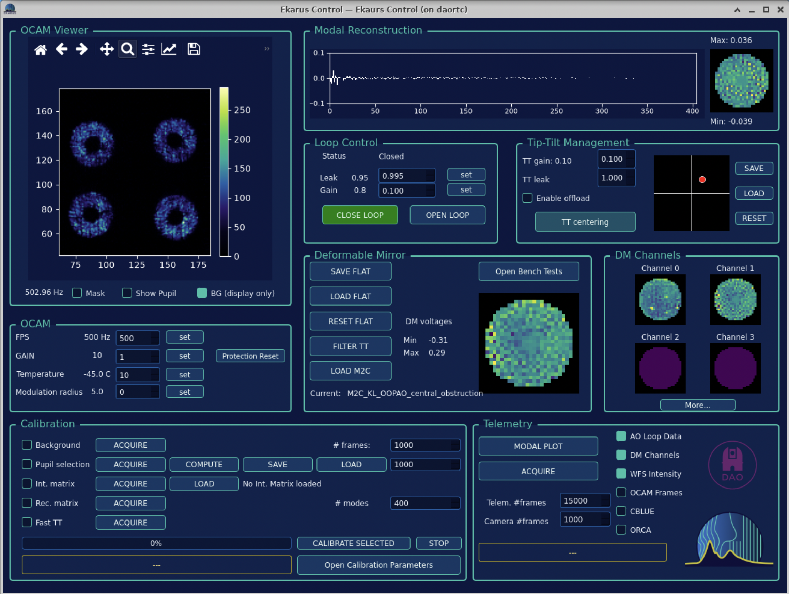
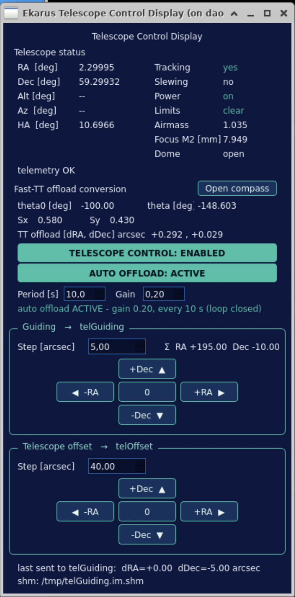
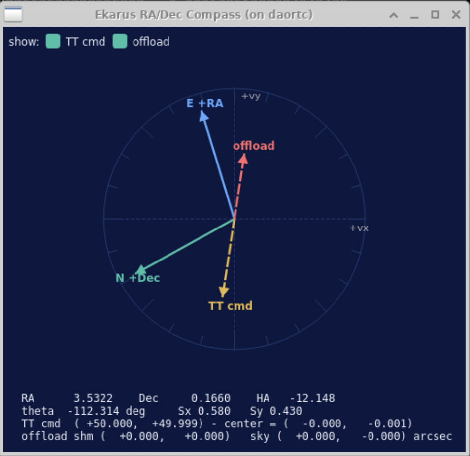

# daoEkarus

Real-time control (RTC) software for the **EKARUS** adaptive-optics system,
built on the DAO shared-memory framework.

EKARUS runs a pyramid wavefront sensor (OCAM²k camera + modulator) driving a
468-actuator deformable mirror and a fast tip-tilt stage, with a C-BLUE camera
as a second-stage / diagnostic sensor. Every stage of the loop is a process that
communicates through POSIX shared memory (`dao.shm`); orchestration and operator
commands go through a protobuf ICD server.

## Repository layout

| path | contents |
|------|----------|
| `apps/`   | operational Python tools — loop control (`closeLoop`, `openLoop`, `setLoopGain`, `setLoopLeak`), calibration (`calibration`, `computeInteractionMatrix`, `computeReconstructionMatrix`, `selectBasis`, `select_valid_pixels`), flats & pupils (`save/load/resetFlat`, `save/loadPupils`), fast-TT (`Fast_TT_Loop`, `moveFastTT`, `fastTTCharacterization`), OCAM/CBLUE acquisition start/stop, `setModulation`, `takeBG`, telemetry, and the ICD server `daoEkarusServer.py` |
| `gui/`    | PyQt5 GUIs + `.ui` — `EkarusCtrl` (main control panel), `cblueCtrl` / `cblueGUI` / `orcaCtrl` (camera panels), `telescopeCtrlDisp` + `compassRose` (telescope control / offload, see below), `diagnostics`, `calibrationParameters`, `modalPlot`, `validPixelSelector`, `benchTests`; shared helpers in `GUIUtils.py` |
| `scripts/`| bash orchestration — `daoEkarusStart` / `daoEkarusStop` bring the whole system up/down (DAQ, `daoServer`, DM468, OCAM, C-BLUE and/or ORCA, FastTT, modulator, pyramid pipeline, and — with `-n` — telescope control + offload, all in `tmux` sessions); `daoEkarusStart<Component>` start one stage (`…StartOcamCamera`, `…StartCBLUECamera`, `…StartOrcaCamera`, `…StartDM468`, `…StartFastTT`, `…StartModulator`, `…StartPyramidPipeline`); `daoEkarusCleanup`, `daoEkarusIportFirmwareUpdate`, `daoEkarusTwinStart` |
| `src/`    | `daoEkarusShmNames.py` — the authoritative list of every SHM path and what it holds; `daoEkarusShmMap.py`, `ekarus_telemetry_keys.py` |
| `proto/`  | `daoEkarusICD.proto` — the operator ↔ server interface (protobuf over TCP) |
| `config/` | `daoEkarusServerConfig.yaml`, `iportOcam.pvxml` |
| `service/`| `ekarus-server.service` — systemd **user** unit for the ICD server |
| `datelab/`, `notebooks/` | offline telemetry / calibration analysis |
| `diagrams/`, `docs/` | pipeline diagram, Sphinx + Doxygen docs |

## Prerequisites

- **daoBase** and **daoHw** installed into `$DAOROOT` (this repo uses their SHM
  library, `daoServer`, `daoDAQ`, and the camera / DM / tip-tilt controllers).
- `protoc` (protobuf compiler) and the shared `.proto` files from daoBase.
- Python: `numpy`, `astropy`, `PyQt5`, `pyqtgraph`, `matplotlib`, `maoppy`
  (PSF fitting, used by the CBLUE seeing estimator), plus `dao`.
- `tmux` for the start scripts.
- `wmctrl` (or `xdotool`) — used by `daoEkarusStart` to keep the "Ekarus
  started" popup raised above the GUIs; `zenity` or `xmessage` for the popup
  itself. Without them startup still works, the popup just may open behind a
  GUI window.

Environment: `DAOROOT`, `DAODATA`, and `DAOROOT/bin` on `PATH`,
`DAOROOT/python` on `PYTHONPATH` (see `service/ekarus-server.service` for the
full list the deployed server uses).

## Build

```bash
waf configure --prefix=$DAOROOT
waf
waf install
```

`configure` sets `PYTHONDIR=$PREFIX/python`, `DATADIR=$PREFIX/data`,
`CONFDIR=$PREFIX/config`. `build` compiles `proto/daoEkarusICD.proto` (C++ + Python
stubs) and installs:

| source | destination |
|--------|-------------|
| `apps/*.py`, `gui/*.py`, `scripts/*` | `$DAOROOT/bin` |
| `src/*.py`, generated `*_pb2.py` | `$DAOROOT/python` |
| `gui/*.ui`, `logo/*.png` | `$DAOROOT/data` |
| `config/*.yaml`, `config/*.pvxml` | `$DAOROOT/config` |

Docs: `waf build_docs` (Doxygen + Sphinx → `docs/build/html`), `waf clean_docs`.

## Running

Bring the system up / down:

```bash
daoEkarusStart      # DAQ, daoServer, DM468, OCAM, 2nd-stage camera(s), FastTT, modulator, pipeline
daoEkarusStart -c   # ... with the C-BLUE controller only  (default: both C-BLUE and ORCA)
daoEkarusStart -o   # ... with the ORCA controller only
daoEkarusStart -n   # ... night time: also telescope control + fast-TT offload (see below)
daoEkarusStop
```

Each stage runs in its own `tmux` session (`DAQ`, `DAO_SERVER`, `OCAM_*`,
`CBLUE_*`, `ORCA_CONTROL`, `FASTTT_*`, and with `-n` `TELESCOPE_*`). The
second-stage camera controllers are started by `daoEkarusStartCBLUECamera`
(C-BLUE via `daoGigeReader` + `daoHwStandaloneCblueCtrl`) and
`daoEkarusStartOrcaCamera` (`daoOrcaCtrl.py`, DCAM). `daoEkarusStart` also opens
the matching camera GUI(s), and a start-up popup reminds you which mode
(day / `-n` night) is running.

`daoEkarusStop` / `daoEkarusCleanup` first Ctrl-C the ORCA streamer and wait for
its DCAM teardown to finish (otherwise the USB camera is left open and the next
start has to wait out the USB stack) before `tmux kill-server`.

Operator panel:

```bash
EkarusCtrl.py
```



One window over the whole loop: the **OCAM viewer** (pyramid pupils, FPS, mask /
pupil overlay), **Modal Reconstruction** live modal coefficients + DM residual,
**Loop Control** (status / leak / gain, close / open loop), **Tip-Tilt
Management** (TT gain / leak, centering, offload enable), **Deformable Mirror**
(save / load / reset flat, filter TT, M2C) and its four **DM Channels**, the
**OCAM** camera settings (FPS, gain, temperature, modulation radius), the
**Calibration** sequence (background, pupil, interaction / reconstruction matrix,
fast TT) and **Telemetry** capture.

### Camera panels

Standalone viewer + control GUIs, one per camera. Each attaches to the camera
image SHM and its sibling control SHMs (created by the matching daoHw streamer /
controller) — nothing talks to the hardware directly.

```bash
cblueCtrl.py -s /tmp/cblue.im.shm     # First Light C-BLUE
orcaCtrl.py  -s /tmp/orca.im.shm      # Hamamatsu ORCA
```

- **`cblueCtrl.py`** — pyqtgraph viewer (colormap, Lin/Sqrt/Log, freeze,
  auto/manual levels, crosshair, rolling average, zoom→ROI) plus C-BLUE controls
  (DIT, FPS, gain, pixel format, cooling setpoint, conversion efficiency),
  background acquire/subtract, data-cube / average acquisition, and the
  PSF-based Strehl / seeing estimator (`maoppy`) and optical-gain calibration
  launcher used during pyramid operation.
- **`orcaCtrl.py`** — same viewer, wired to the `daoOrcaCtrl.py` streamer SHMs
  (`Dit`, `Fps`, `ReadoutSpeed`, `SetTemp`, `Roi`, `Temp`) with cube / average /
  background acquisition. A stripped-down display-only variant,
  `daoOrcaDisp.py`, lives in `daoHw/hamamatsu/`.

## Telescope control & fast-TT offload

At night (`daoEkarusStart -n`) three extra processes bridge the AO loop to the
Copernico telescope, plus a control GUI. All the numbers below are `/tmp/*.im.shm`
paths defined in `src/daoEkarusShmNames.py` (`SHM_TELESCOPE_*`).

| tmux session | process | role |
|---|---|---|
| `TELESCOPE_CTRL` | `telescopeCtrl.py` — runs in the `ekarus` conda env (needs `ekarus_tcs`) | the **only** process that talks to the TCS. Publishes the telescope telemetry every ~1 Hz / ~0.2 Hz: `telRaDec`, `telAltAz` (Alt/Az/HA), `telStatus` (power / tracking / slewing / limits), `telAirmass`, `telFocus` (M2), `telDome`. Forwards `telGuiding` / `telOffset` to `client.set_guiding()` / `client.set_offset()`, gated by the master `telControlEnable` switch; `set_offset` is skipped while the mount is slewing. |
| `TELESCOPE_OFFLOAD_CALC` | `computeTelescopeOffload.py` | the pointing-offset calibration, recomputed every cycle: `theta = theta0 + HA - Dec`, the 2×2 matrix `rotMat = R(theta)·diag(Sx, Sy)`, and `telTtOffload = -(rotMat · (fastttAvg - 50))` (50 = PI tip-tilt stage centre). Publishes `telThetaAngle`, `telRotMat`, `telTtOffload`. `theta0` / `Sx` / `Sy` are live-tunable via `telTheta0` / `telScale`. |
| `TELESCOPE_OFFLOAD_LOOP` | `telescopeOffload.py` | the slow offload loop. Every `telOffloadPeriod` s, **if** `telOffloadEnable` is on **and** the fast-TT loop is closed (`fast_tt_lpCmd`), writes `telOffloadGain · telTtOffload` into `telGuiding`. |

`fastttAvg` (`SHM_FASTTT_CMD_AVG`, `/tmp/fastttAvg.im.shm`) is a rolling mean of
the fast-TT mirror command produced by a `daoAvgShm` started in
`daoEkarusStartFastTT` (`FASTTT_AVG` tmux session).

### data flow

```
             fast TT loop  ──►  /tmp/fasttt.im.shm  ──►  daoAvgShm  ──►  fastttAvg
                                                                           │
   telAltAz(HA), telRaDec(Dec)                    computeTelescopeOffload.py
     (from telescopeCtrl.py)  ─────────────────────────────► │
                                                telTheta / telRotMat / telTtOffload
                                                             │
        telOffloadEnable / Period / Gain  ──►  telescopeOffload.py
                                                  telGuiding = gain · telTtOffload
                                                             │
                        telControlEnable  ──►  telescopeCtrl.py
                                               client.set_guiding(x, -y)     (*)
                                                             │
                                                       Copernico TCS
```

(*) `telescopeCtrl.py` is the single place a per-axis TCS sign lives
(`TCS_GUIDING_SIGN` — the Copernico guiding Dec axis is inverted w.r.t. sky).
Everything upstream — the hand paddles, `computeTelescopeOffload.py`, the
compass — works in plain sky RA/Dec, so **what the GUI shows is what the
telescope does**.

### control GUI — `telescopeCtrlDisp.py`

Started automatically by `daoEkarusStart -n` (or `telescopeCtrlDisp.py`).



- **Telescope status** — the full TCS telemetry.
- **Fast-TT offload conversion** — `theta0`, `Sx`, `Sy`, the live `theta` and the
  resulting `[dRA, dDec]` offload vector, plus **Open compass**.
- **TELESCOPE CONTROL** — master enable (`telControlEnable`); until it is on,
  `telescopeCtrl.py` sends nothing to the TCS (default off).
- **AUTO OFFLOAD** + **Period [s]** / **Gain** — drive the `telescopeOffload.py`
  control SHMs (`telOffloadEnable` / `telOffloadPeriod` / `telOffloadGain`); the
  status line shows `active / inactive` and whether the fast-TT loop is open.
- **Guiding** and **Telescope offset** hand paddles — `+RA/-RA/+Dec/-Dec/0`
  buttons writing `telGuiding` / `telOffset` in arcsec; the offset paddle
  disables itself while the mount is slewing.

### RA/Dec compass — `compassRose.py`

`compassRose.py`, or the **Open compass** button.



In the fast-TT command frame (`+vx` right, `+vy` up) it shows where **+RA (East)**
and **+Dec (North)** point given `theta` and `Sx/Sy` (unequal scales → the N and
E arrows are not exactly 90° apart, which is correct). The two checkboxes overlay
the current TT command (`fastttAvg − 50`) and the sky offload vector; with both
on the offload arrow is exactly opposite the TT command.

### ICD server

`daoEkarusServer.py` speaks length-prefixed protobuf `Request`/`Response` frames
on TCP (default port 5050); `--sim` runs against a simulator.

```bash
daoEkarusServer.py                 # live, port 5050
daoEkarusServer.py --sim -p 6000   # simulator on port 6000
```

Deploy it as a systemd user service (installs the unit, `daemon-reload`,
enable + start, and enables linger):

```bash
waf deploy_service
```

## Shared memory

`src/daoEkarusShmNames.py` is the single source of truth — every constant is a
`/tmp/*.im.shm` path with an inline comment describing its contents (DM channels
and combined command, OCAM raw/descrambled/reduced frames, reconstructor
matrices, loop gain/leak, modulation, telemetry, the `SHM_TELESCOPE_*` control
and offload SHMs, …). Import it rather than hard-coding paths:

```python
import daoEkarusShmNames as shm
cmd = dao.shm(shm.SHM_DM1_CMD)
```
