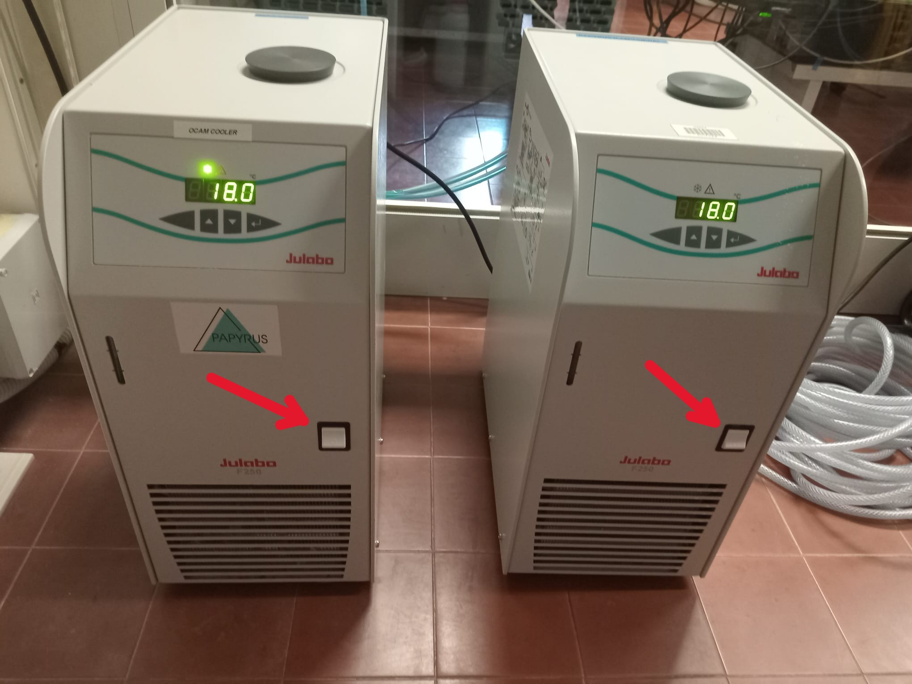
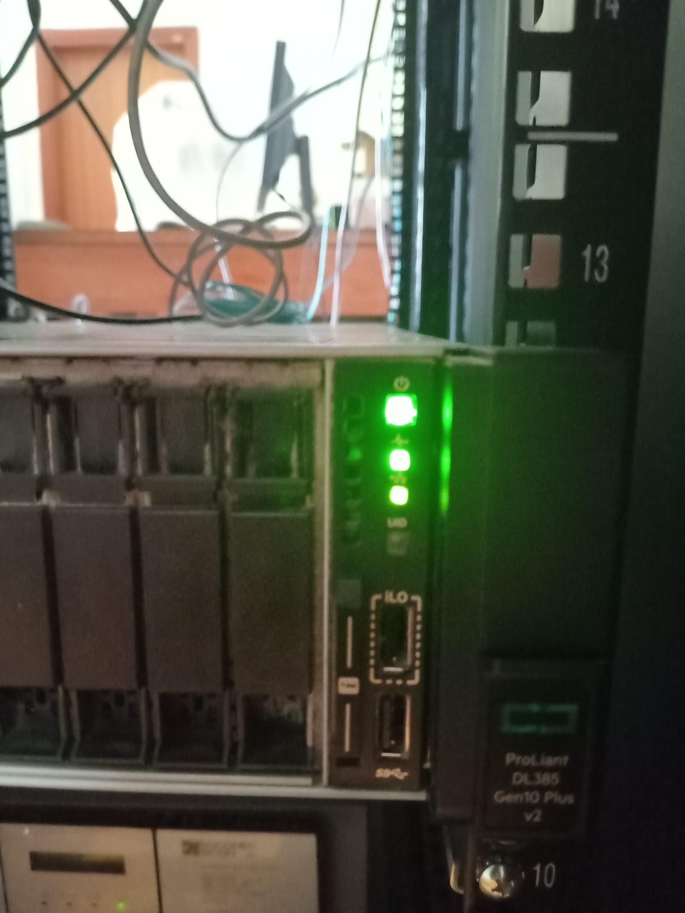
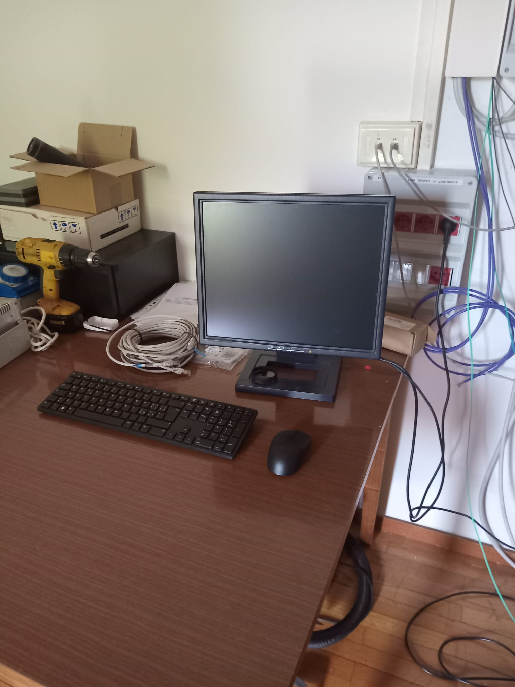
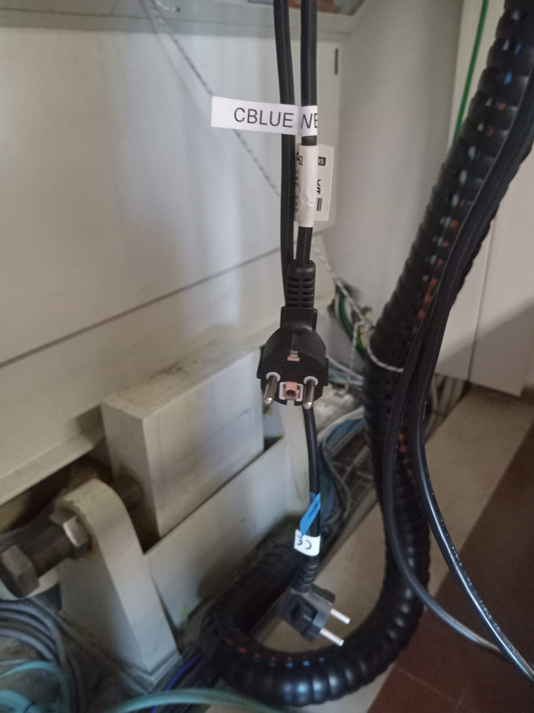

===================
Operating the bench
===================

To operate Ekarus you need to turn on several pieces of equipment. Here you can find a sequence that you can follow to turn on and off the bench in a sequre way.

Turn on sequence
----------------

Turn on the chillers
~~~~~~~~~~~~~~~~~~~~

You can find the chillers in the "Aquarium", in the control room. To turn them on, flick the white switch indicated in the picture. After around 10 seconds they should start. 

.. warning::
    Wait for the chillers to indicate around 18 degrees before turning on the Ocam.

Turn on the RTC
~~~~~~~~~~~~~~~

You can find the RTC in the electronics lab. To turn on, press the small-organge-lighted square: it should turn green.

Diagnostics
^^^^^^^^^^^

If needed, you can use the keyboard and mouse to operate directly on the RTC

Turn on the Fast TT and DM
~~~~~~~~~~~~~~~~~~~~~~~~~~

You can find the electronics for the Fast TT and deformable mirrors in the rack. To turn on the fast TT flick the switch on the back of the PI electronics box. To turn on the DM press on the button bellow the `power` and `data` indicator lights.

.. list-table::
   :widths: 33 33 33
   :align: center

   * - .. image:: Images/rack.jpeg
          :width: 100%

     - .. image:: Images/fastTT_electronics.jpeg
          :width: 100%

     - .. image:: Images/dm_electronics.jpeg
          :width: 100%

Turn on the modulator
~~~~~~~~~~~~~~~~~~~~~

To turn on the modulator you need to flick the switch in the PI electronics box, currently installed in the bench 

Turn on the cameras
~~~~~~~~~~~~~~~~~~~

To turn the cameras on you need to plug the corresponding cable. The Cblue is labeled, while the Ocam is not.

.. warning::
    Make sure that the chillers are ON and at around 18 degrees before pluging in the Ocam

